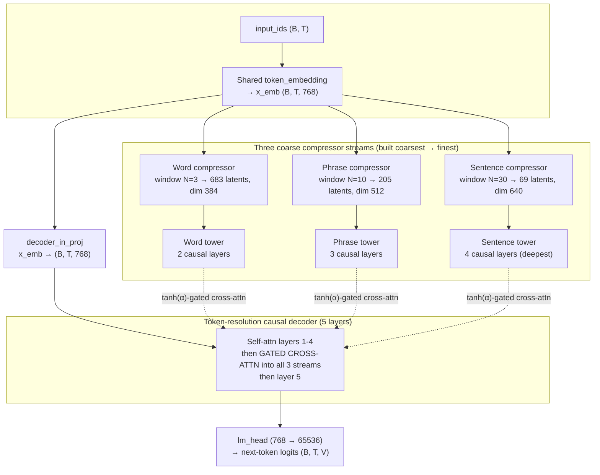
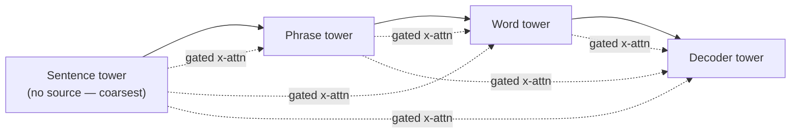
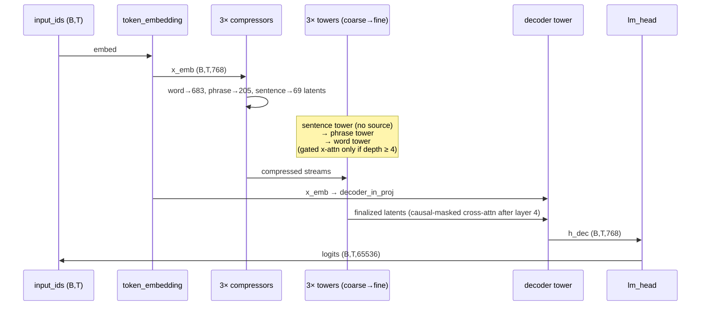

# The Causal Hierarchical-Thinking Model, Explained

> A walkthrough of the model trained by
> [`causal_pretrain.yaml`](causal_pretrain.yaml) — the **clean A/B arm** against
> nanochat. Same tokenizer, same next-token objective, same tokens/steps/schedule;
> the **multi-scale hierarchical architecture is the only variable**.
>
> Model class: [`HierarchicalLM`](../../../src/model/hierarchical_lm.py) ·
> config: [`model/hierarchical_thinking/causal_lm_v0.yaml`](../../model/hierarchical_thinking/causal_lm_v0.yaml)
> · ~188.2M params (vs nanochat's 185.6M, +1.4%).

---

## 1. The one-paragraph version

A vanilla decoder-only LM reads a flat sequence of tokens and predicts the next
one. `HierarchicalLM` keeps that token-resolution decoder but **also** builds
three *coarser* summaries of the same text in parallel — one latent per **3
tokens** (≈ word), per **10 tokens** (≈ phrase), and per **30 tokens** (≈
sentence). The decoder, right before its final layer, gets to *look up* into
these coarse summaries through **gated cross-attention**, so when it predicts
token *t* it can consult not just the raw tokens to its left but a compressed
"gist" of the recent words, phrases, and sentences. Everything is masked so that
no coarse summary can leak information from the future — the model stays strictly
causal and trains with the exact same cross-entropy loss as nanochat.

---

## 2. A running example

We'll trace this sentence through the model. BPE tokens are sub-words, but for
readability we'll pretend one word = one token:

```
tokens:  [The] [quick] [brown] [fox] [jumps] [over] [the] [lazy] [dog] [runs] [off] [now]
index:     0      1       2      3      4      5      6      7      8      9    10    11
```

So `T = 12` tokens. In a real run `T = 2048` (`max_length`), but 12 keeps the
window math legible.

---

## 3. The big picture



Four "readers" of the same embedded text run in parallel:

| Reader | Window `N` | # latents @ T=2048 | Latent dim | Tower depth | Role |
|---|---|---|---|---|---|
| **Decoder** | 1 (every token) | 2048 | 768 | 5 | The surface generator — emits logits |
| **Word** stream | 3 | 683 | 384 | 2 | Fine "chunk" gist |
| **Phrase** stream | 10 | 205 | 512 | 3 | Mid-range gist |
| **Sentence** stream | 30 | 69 | 640 | 4 (deepest) | Long-range "thinking" gist |

Note the **inverse tiering**: the coarser the stream, the *fewer* latents it has,
so we can afford to make its tower *deeper and wider*. The sentence tower is the
most expensive per-latent but runs on only 69 positions.

---

## 4. Component by component

### 4.1 Shared token embedding

```
input_ids (B, T) ──► token_embedding [65536 × 768] ──► x_emb (B, T, 768)
```

One `nn.Embedding` of vocab 65 536 → 768-d. **Every** reader (decoder + all three
compressors) starts from this *same* `x_emb`. The embedding matrix (`65536×768`)
plus the untied `lm_head` (`768×65536`) account for **100.7M** of the 188M
params — identical to nanochat.

### 4.2 The sliding-window compressor — how coarse latents are made

Each stream uses a [`SlidingPerceiverCompressor`](../../../src/model/sliding_perceiver_compressor.py):
it chops `x_emb` into **non-overlapping windows of `N` tokens** and runs a tiny
1-latent [`PerceiverResampler`](../../../src/model/perceiver_resampler.py) on each
window. One learnable latent cross-attends into the `N` token embeddings and comes
out as a single vector — the window's summary.

**Word stream (N=3) on our example:**

```
x_emb positions:   0   1   2 │ 3   4   5 │ 6   7   8 │ 9  10  11
                 [The quick brown][fox jumps over][the lazy dog][runs off now]
                        │               │              │             │
                   Perceiver(1)    Perceiver(1)   Perceiver(1)  Perceiver(1)
                        ▼               ▼              ▼             ▼
word latents:          w0              w1             w2            w3     → (B, 4, 384)
covers tokens:       [0..2]          [3..5]         [6..8]        [9..11]
end token index:       2               5              8             11
```

If `T` isn't a multiple of `N`, the tail is **right-padded with zeros** so the
last window still forms. Because windows are disjoint and left-to-right, latent
`p` depends *only* on tokens `[p·N, p·N+N-1]` — **causal by construction**.

- **Phrase stream (N=10):** windows `[0..9]`, `[10..11]`(padded) → 2 latents,
  end indices `9`, `19`. Dim 512.
- **Sentence stream (N=30):** one window `[0..11]`(padded) → 1 latent, end index
  `29`. Dim 640.

The single most important bookkeeping quantity is the **end token index** of each
latent — window `p` at scale `N` *ends* at token `p·N + N − 1`. This is what makes
cross-scale causality checkable (§5).

### 4.3 The causal stream towers

After compression, each stream runs its own stack of **causal** transformer
blocks — the same [nanochat `Block`](../../../src/model/nanochat_gpt.py)
(pre-norm, RoPE, QK-norm, squared-ReLU MLP) that the baseline uses, just on the
compressed sequence. So the sentence tower's 4 layers attend over only 69 latent
"positions," letting each sentence-summary refine itself using earlier
sentence-summaries.

Towers are built **coarsest → finest** (sentence, then phrase, then word) so that
when a finer tower wants to consult a coarser one, the coarser hiddens are already
finalized:



### 4.4 Gated causal cross-attention — the top-down wiring

This is the heart of the architecture: how a finer reader *pulls in* a coarser
reader's gist. Implemented by
[`GatedCausalCrossAttention`](../../../src/model/hierarchical_lm.py):

```
   query = current tower hiddens  (e.g. decoder, dim 768)
   key/value = a coarser stream   (e.g. sentence latents, dim 640)

   ┌──────────────────────────────────────────────────────────┐
   │  q = Q·RMSNorm(x)                                          │
   │  k,v = KV·[ null_context , coarse_latents ]   ← learned    │
   │                                              zero-init null│
   │  attn = softmax( qkᵀ  +  causal_mask )                     │
   │  out  = attn · v                                          │
   │  x  ←  x  +  tanh(α) · Out·out          α initialised to 0 │
   └──────────────────────────────────────────────────────────┘
```

Three design details make this safe and stable:

1. **`tanh(α)` gate, `α = 0` at init** (Flamingo recipe). At step 0,
   `tanh(0) = 0`, so the cross-attention contributes *nothing* — the model is
   **exactly** a decoder-only LM. It then *learns* how much to open each gate. A
   gate that stays near 0 after training means "this stream isn't useful"; gates
   that grow mean the streams are being used. (See the README diagnostics:
   inspect `*_alpha` and confirm a gate-zero ablation worsens perplexity.)
2. **Learned zero-init null key/value**, prepended to every context. An early
   query (e.g. token 0 under the N=30 window) may have *no* visible coarse latent
   yet. Without the null, its attention row would be fully masked → `softmax` over
   `-inf` → NaN. The always-visible null gives it something to attend; being
   zero-valued with bias-free projections, its contribution is exactly zero.
3. **No RoPE here.** Query and key live at *different* token-index scales (token
   *t* vs sentence-latent covering tokens 60–89), so positional rotation would be
   meaningless. Ordering is instead enforced by the explicit causal mask below.

### 4.5 The decoder and the head

The decoder tower runs on the full token-resolution sequence (projected to 768 by
`decoder_in_proj`, here an `Identity` since dims match). It's 5 causal layers;
after layer 4 it cross-attends into **all three** finalized streams, then runs
layer 5, `RMSNorm`, and the untied `lm_head` → logits `(B, T, 65536)`.

---

## 5. Causality across scales — the single invariant

The whole model is strictly causal because of **one rule**, enforced on every
cross-attention:

> A query whose end-index is `e` may attend a coarse latent only if that latent's
> end-index is `≤ e`.

In code ([`hierarchical_lm.py`](../../../src/model/hierarchical_lm.py)):

```python
masks = [src_end.unsqueeze(0) <= self_end_idx.unsqueeze(1) for src_end in source_end_idx]
```

**Why it works:** a coarse latent with end-index `> t` summarizes at least one
token *after* `t`. Hiding it from the token-`t` prediction guarantees that
perturbing any future token `t' > t` can't change the logits at `t`.

**Worked mask — decoder (query = each token 0..11) attending the word stream**
(latents end at 2, 5, 8, 11):

```
                       word latent end-index
                        w0=2  w1=5  w2=8  w3=11
   token 0  (e=0)  ►     ✗     ✗     ✗     ✗     → only the null (nothing visible yet)
   token 2  (e=2)  ►     ✓     ✗     ✗     ✗     → may see w0 (covers tokens 0-2)
   token 5  (e=5)  ►     ✓     ✓     ✗     ✗
   token 8  (e=8)  ►     ✓     ✓     ✓     ✗
   token 11 (e=11) ►     ✓     ✓     ✓     ✓
```

Notice token 0–1 see *no* word latent (w0 only finishes at token 2), so they fall
back on the null — exactly the case §4.4's null key was built for. The same rule
governs stream-to-stream attention (phrase attending sentence, etc.).

---

## 6. Where cross-attention *actually* fires in this config

Injection points are scheduled every `cross_attn_every = 4` layers:
`schedule = [i for i in range(num_layers) if (i+1) % 4 == 0]`.

| Tower | Layers | Injection layers | Coarser sources | Cross-attn active? |
|---|---|---|---|---|
| Sentence | 4 | layer 4 | none (coarsest) | — (no sources) |
| Phrase | 3 | none | sentence | **no** (depth < 4) |
| Word | 2 | none | phrase, sentence | **no** (depth < 4) |
| **Decoder** | 5 | layer 4 | word, phrase, sentence | **yes** ✓ |

⚠️ **A real property of `causal_lm_v0`:** because the coarse towers are shallower
than `cross_attn_every`, the only place top-down conditioning happens is the
**decoder**, which reads all three streams once (after its 4th layer). The
inter-stream bridges (phrase←sentence, word←phrase) exist in the architecture but
are *inactive* at this depth/`cross_attn_every`. The streams still refine
themselves via self-attention; they just don't cross-talk before reaching the
decoder. To activate inter-stream conditioning, lower `cross_attn_every` (e.g. to
2) or deepen the coarse towers.

---

## 7. Forward pass, end to end



The `forward` returns a **plain logits tensor** (no aux head, unlike the
diffusion arm's `MultiScaleLM`), so it drops straight into the default `Trainer`
and the `lm_pretrain` cross-entropy loss with zero trainer changes — which is the
whole point of the clean A/B.

---

## 8. Parameter budget (~188.2M)

| Group | Params | Notes |
|---|---|---|
| Token embedding + `lm_head` | 100.7M | `2 × 65536 × 768`, identical to nanochat |
| Decoder tower | 41.3M | 5 layers @ dim 768, ff 3072 |
| Coarse towers | 27.2M | word (2×384) + phrase (3×512) + sentence (4×640) |
| Compressors | 19.1M | 3× `SlidingPerceiverCompressor` |
| **Total** | **~188.2M** | vs nanochat 185.6M (+1.4%, within the ±2% match band) |

---

## 9. Optimizer partition — why Muon *and* AdamW

Config: [`optimizer/muon_adamw_hierarchical.yaml`](../../optimizer/muon_adamw_hierarchical.yaml),
partition [`hierarchical_default`](../../../src/optimizer/param_groups.py).

Two sub-optimizers, split by parameter *shape/role*:

| Optimizer | LR | Gets | Rationale |
|---|---|---|---|
| **Muon** | 0.02 | 2-D "reasoning" matrices: tower/decoder attention + MLP weights, cross-attention projections, compressor cross-attn projections | Newton–Schulz orthogonalization belongs on dense matrices |
| **AdamW** | 0.0008 | everything else: `token_embedding`, `lm_head`, Perceiver **learnable latents**, RMSNorm/LayerNorm scales, the `tanh` **gates** (`α`), null contexts, all 1-D params | Lookup tables & scalars shouldn't be orthogonalized |

The key hierarchical-specific twist (vs plain `muon_adamw`): the Perceiver
compressors' **learnable latent arrays** are 2-D but are *lookup tables*, not
reasoning matrices — so `is_hierarchical_matrix_param` explicitly routes them to
AdamW.

---

## 10. Training objective & how it matches nanochat

- **Loss** ([`lm_pretrain.yaml`](../../loss/lm_pretrain.yaml)): plain next-token
  cross-entropy. The dataset already shifts (`input = tokens[:-1]`,
  `target = tokens[1:]`), so `ShiftedTeacherForcing(shift=0)` applies CE directly.
- **Data**: FineWeb-EDU (streaming), 65k byte-level BPE tokenizer
  (`artifacts/tokenizer/nanochat_bpe.json`) — **no** `<|mask|>` sentinel (this arm
  never masks), so vocab is exactly 65 536.
- **Schedule**: warmup-cosine, 750 warmup / 7500 total optimizer steps,
  `min_lr_ratio=0.001`.
- **Batch**: global batch 256 ≈ 0.524M tokens/step → ~3.9B tokens (~21×/param,
  ≈ Chinchilla-optimal), **matched** to the nanochat & recursive_memory arms.
- **Metrics**: next-token accuracy + bits-per-byte (`lm_eval_metrics` callback,
  ordered before `WandbCallback` so its metrics get logged).

Every one of these — dataset, loss, metrics, tokens, steps, schedule, global
batch — is a **byte-for-byte clone of `experiment/nanochat/pretrain.yaml`**. Only
the model and the optimizer partition differ, so any difference in perplexity /
bpb / accuracy is attributable to the hierarchical architecture alone.

---

## 11. What to watch during training

From the [README diagnostics](README.md#diagnostics--what-to-watch):

1. **Gate magnitudes grow.** Inspect the `*_alpha` scalars — `tanh(α)` starting at
   0 should drift away from 0 if the decoder finds the streams useful.
   ```python
   gates = {k: v.item() for k, v in sd.items() if k.endswith("alpha")}
   ```
2. **Gate-zero ablation should hurt.** Zero all gates at inference and re-evaluate;
   perplexity should *worsen*. If it doesn't, the conditioning streams aren't
   contributing and the model has collapsed to a plain decoder.
3. **Perplexity/bpb vs nanochat.** The headline A/B number — does the extra
   hierarchical machinery beat a param-matched flat decoder at equal tokens?

---

## 12. TL;DR mental model

> A normal decoder-only LM, plus three parallel "note-takers" summarizing the same
> text at word/phrase/sentence granularity. The decoder consults those notes
> through gates that start shut and open only if the notes help — all while a
> single end-index rule keeps every note strictly in the past.
